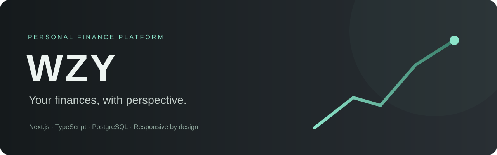
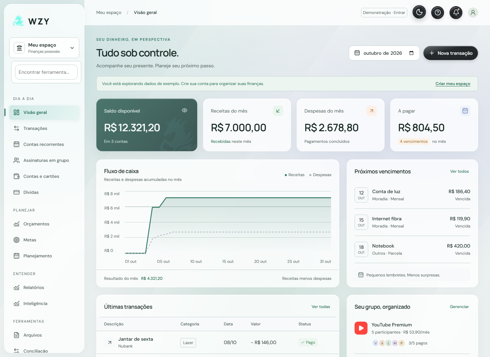
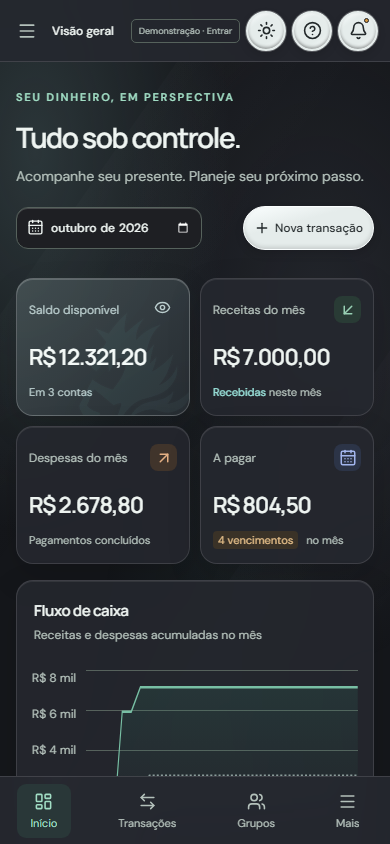
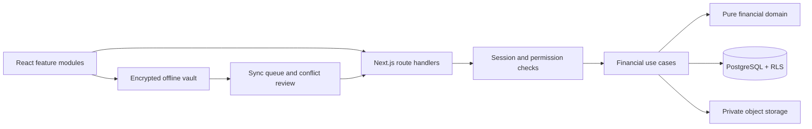

<p align="center"></p>

<p align="center">
  <a href="https://github.com/BrenolucsPH/wzy-finance/actions/workflows/quality.yml"></a>
  
  
  
</p>

<p align="center"><a href="README.pt-BR.md">Português</a> · <a href="https://wzy-breno-c7b0.vercel.app/">Live application</a> · <a href="docs/SETUP.md">Setup</a> · <a href="docs/USO.md">User guide</a> · <a href="SECURITY.md">Security</a></p>

# WZY Finance

A personal finance platform that combines a responsive interface with explicit financial rules, account isolation and recoverable workflows. The product interface is in Brazilian Portuguese; engineering documentation is provided for an international portfolio audience.

**Explore the live application without signing in:** its demonstration mode uses sample data. This repository contains the complete application backend, including protected administration and scheduled jobs, with no production credentials or user database.


## What this project demonstrates

| Engineering concern | Implementation |
| --- | --- |
| Financial integrity | Integer cents, exact proportional splits, fractional investment quantities, closed invoice cycles and append-only corrections |
| Concurrent writes | Database transactions, stable operation identifiers and version checks that reject stale edits |
| Multi-user isolation | Server authorization plus PostgreSQL row-level security; group sharing is limited to accepted participants |
| Large histories | Server aggregates independent of the visible page and cursor-based transaction lists |
| Recovery | Encrypted private snapshots, verified migration checkpoints and preview-based data restoration |
| Intermittent connectivity | Password-encrypted IndexedDB vault, persistent sync queue and explicit conflict handling |
| Product usability | Guided first transaction, useful empty states, customizable navigation, keyboard access and responsive layouts |
| Verification | Pure financial invariants, API integration checks and real headless-browser flows with synthetic users |

## Product capabilities

- Multiple accounts and wallets; income, expenses, transfers, tags, attachments and cost centers.
- Recurring bills, debts, installment purchases and credit card invoice cycles with partial payments and refunds.
- Family subscriptions with proportional splits, invitations, participant permissions and payment tracking.
- Budgets with rollover, savings goals, calendar, projected cash flow and scenario simulation.
- CSV/OFX reconciliation, PDF/Excel exports, currency conversion and a manually maintained investment portfolio.
- Local financial queries, spending comparisons and duplicate/outlier indicators.
- Profiles, private avatars, device/session management, authenticator-based 2FA and passkeys.
- Dark/light themes, frosted glass surfaces, reduced-motion support and skeleton/ripple loading states.

<details>
<summary>Light theme and mobile interface</summary>





</details>

## Run the interface locally

Requires **Node.js 24.x** and npm. The lockfile is committed.

```sh
git clone https://github.com/BrenolucsPH/wzy-finance.git
cd wzy-finance
npm ci
npm run dev
```

Open [localhost:3000](http://localhost:3000). Without backend credentials, use demonstration mode to inspect the interface. Registration, persistence, uploads and privileged operations require your own configuration; they are not simulated as successful writes.

For the full system, follow [SETUP.md](docs/SETUP.md). Copy `.env.example` to `.env.local`, configure an isolated Neon/PostgreSQL database, a private Blob store and locally generated keys, then run the versioned migrations. Never reuse production credentials for experiments.

## Architecture



The project uses a **modular monolith**: feature boundaries and database transactions without the operational overhead of microservices. [Architecture](docs/ARQUITETURA.md) explains the domain, consistency decisions and current trade-offs. [Design notes](docs/DESIGN.md) cover navigation, accessibility and motion.

```text
app/features/         Product journeys: accounts, invoices, groups, planning, offline
app/api/              Validated and authorized HTTP boundaries
lib/domain/           Pure money, invoice, portfolio and restoration rules
lib/modules/          Transactional use cases and read models
db/                   Canonical PostgreSQL schema and versioned SQL migrations
scripts/verify-*.mjs   Isolated integration and browser verification
docs/                 Setup, usage, architecture, design and testing
```

## Verification

```sh
npm run check:secrets  # tracked-file publication checks
npm run check         # lint, TypeScript and database-free invariant checks
npm run build:app     # application compilation only; no database migration
```

The full verification suite covers **72 check groups**, including 2,000 varied exact-split cases, 5,000 transactions, user isolation, concurrent edits, private files, restoration and mobile browser layouts. The initial application release passed these checks locally and in its deployment build. The public snapshot is separately checked; see [TESTING.md](docs/TESTING.md) for reproducible commands and the distinction between automated and physical-device coverage.

GitHub Actions runs publication checks, lint, types, pure tests, an application build and a production dependency audit. It does **not** receive deployment credentials or automatically publish this repository to the live service.

## Current boundaries

- Bank/Open Finance synchronization is not implemented. CSV/OFX imports remain available.
- Asset prices are entered manually. Currency quotes have a source date and an explicit stale fallback.
- Financial queries use local deterministic rules.
- Email, SMS and push require separate provider/device configuration. These integrations are inactive without it.
- Automated browser viewport checks do not replace physical-device, assistive-technology or concurrent-load testing.
- Security controls and privacy features are implemented; this is not an independent security audit or legal compliance certification.

## Development and publication

Personal project by [Breno Lucas](https://github.com/BrenolucsPH), developed iteratively with automated verification. This repository presents the implementation and its testable decisions; it does not claim commercial scale or independently certified security.

The public repository begins with a reviewed, sanitized snapshot. Production history, internal runbooks, environment files, operational identifiers, user uploads and databases are excluded. Public route names are intentionally visible; access is enforced by authentication, authorization and database policies.

**License status:** source-available portfolio; no open-source reuse license has been selected. See [LICENSE.md](LICENSE.md) and [THIRD_PARTY_NOTICES.md](THIRD_PARTY_NOTICES.md). Dependencies retain their own licenses.
