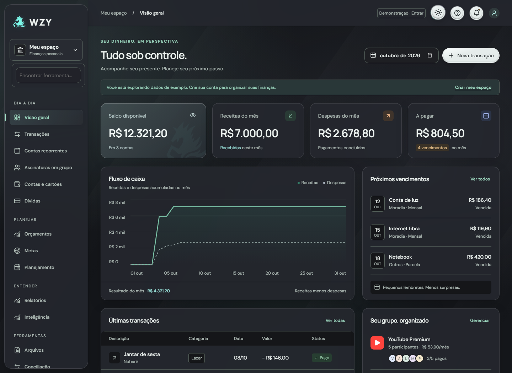

# WZY — Controle financeiro pessoal

[English](README.md) · [Aplicação](https://wzy-breno-c7b0.vercel.app/) · [Como usar](docs/USO.md) · [Instalação](docs/SETUP.md)

Sistema de finanças pessoais com contas independentes por usuário, interface responsiva, temas claro/escuro e fluxos que preservam a integridade dos registros.



## Recursos

- Contas, carteiras, receitas, despesas, transferências, comprovantes e categorias próprias.
- Contas recorrentes, dívidas, compras parceladas e faturas com pagamentos parciais e estornos.
- Assinaturas em família, divisão proporcional, convites e controle de participantes.
- Orçamentos com sobra para o mês seguinte, metas, calendário, projeções e cenários.
- Conciliação OFX/CSV, relatórios PDF/Excel, moedas e investimentos com cotação manual.
- Consultas financeiras locais, comparações de gastos e alertas de duplicidade.
- Perfil, dispositivos, revogação de sessões, 2FA por autenticador e chaves de acesso.
- Cofre offline criptografado, fila de sincronização, conflitos visíveis e restauração com prévia.

## Conhecer sem configurar serviços

Use Node.js 24.x e npm:

```sh
git clone https://github.com/BrenolucsPH/wzy-finance.git
cd wzy-finance
npm ci
npm run dev
```

Abra [localhost:3000](http://localhost:3000) e explore o modo demonstrativo. Ele usa dados de exemplo. Para cadastro, persistência e demais recursos do backend, configure seus próprios serviços conforme [SETUP.md](docs/SETUP.md).

## Engenharia

Next.js, React e TypeScript com PostgreSQL/Neon e armazenamento privado no Vercel Blob. O sistema usa módulos por domínio, centavos inteiros, transações de banco, versões contra edições concorrentes, repetição segura de operações e isolamento por proprietário.

O menu padrão agrupa cada seção uma única vez. A ordem personalizada é preservada; quando mistura seções, aparece como uma lista única. Favoritos e preferências são separados por usuário.

- [Arquitetura](docs/ARQUITETURA.md)
- [Interface, acessibilidade e animações](docs/DESIGN.md)
- [Testes e limitações da validação](docs/TESTING.md)
- [Instalação e configuração](docs/SETUP.md)
- [Publicação em ambiente próprio](docs/DEPLOYMENT.md)
- [Política de segurança](SECURITY.md)

## Limites atuais

Integração bancária automática não está implementada. Investimentos usam preços informados pelo usuário. O assistente usa consultas financeiras locais. Email/SMS precisam de provedor; biometria e push precisam de suporte e autorização no dispositivo. Testes automatizados não equivalem a auditoria independente, certificação de acessibilidade ou conformidade jurídica.

## Publicação para portfólio

Esta é uma cópia pública revisada, com histórico novo. Não inclui chaves reais, banco, anexos de usuários, configurações da implantação original ou manuais operacionais internos. O backend está completo e suas rotas continuam protegidas por sessão, permissões e políticas de banco. O site original não é alterado por esta publicação.

Projeto pessoal de [Breno Lucas](https://github.com/BrenolucsPH), com detalhes de implementação e decisões disponíveis para revisão técnica.

Nenhuma licença de reutilização open source foi escolhida. Consulte [LICENSE.md](LICENSE.md). Dependências e recursos de terceiros mantêm suas próprias condições.
